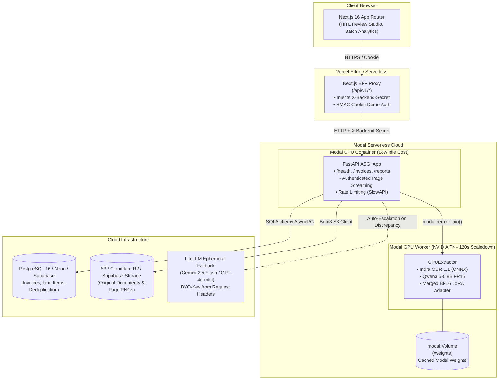

# 📄 Hybrid Document AI Invoice Processor v2

[](https://github.com/GSoumyajit2005/invoice-processor-ml/actions/workflows/ci.yml)
[](https://python.org)
[](https://fastapi.tiangolo.com)
[](https://pytorch.org)
[](https://nextjs.org)
[](https://tailwindcss.com)
[](https://modal.com)
[](https://postgresql.org)
[](https://docs.astral.sh/uv/)

> **A production-grade, enterprise Document AI platform** for automated invoice extraction, mathematical reconciliation, and Human-in-the-Loop (HITL) verification. Powered by a hybrid pipeline pairing **Indra OCR 1.1 (ONNX)** with a fine-tuned **Qwen3.5-0.8B Multimodal Vision-Language Model (LoRA)**, served via a split serverless architecture on **Modal** and **Next.js 16 on Vercel**.

---

## 🚀 Key Highlights & Architectural Evolution

| Capability | Legacy v1 (`v1-legacy-layoutlmv3`) | Modern v2 (Current Production) |
|---|---|---|
| **Extraction Model** | LayoutLMv3 (512-token text/token limits, single-page only) | **Qwen3.5-0.8B Multimodal VLM** + **BF16 LoRA** (merged at load time) |
| **OCR Engine** | DocTR (Mindee PyTorch, high VRAM overhead) | **Indra OCR 1.1** (ONNX Runtime, 15MB weights, 300ms/page on CPU) |
| **Document Support** | Single-page images only | **Multi-page PDFs** rasterized via `pypdfium2` + text extraction via `pdfplumber` |
| **Math Reconciliation** | Basic regex heuristic | **Deterministic Verification Engine** (subtotal, tax, discount, total, GST-inclusive receipts) |
| **Visual Grounding** | None (unconnected bounding boxes) | **Bidirectional [0..1000] SVG Overlay** linking form fields to page boxes |
| **Web Frontend** | Streamlit single-script prototype | **Next.js 16 App Router (React 19, TypeScript)** with glassmorphic design system |
| **Theme & UI** | Default Streamlit theme | **Zero-flash dark/light mode** (`useSyncExternalStore`), frosted glass surfaces |
| **Cloud Deployment** | Monolithic HuggingFace Space | **Split Serverless on Modal** (CPU ASGI app + on-demand T4 GPU worker) + **Vercel** |
| **Package Management** | Traditional `pip` / `requirements.txt` | **Astral `uv` Workspace** (`invoice-backend`, `invoice-ml`, root dev tools) |

---

## 🏗️ System Architecture & Data Flow



### End-to-End Extraction Pipeline
1. **Document Ingestion & Validation:** Magic bytes inspection (`PDF`, `PNG`, `JPEG`, `WEBP`), bounded memory uploads (max 20MB, max 20 pages), and SHA-256 file hashing.
2. **Page Processing:** Multi-page PDF rasterization via `pypdfium2` at 150 DPI, native text layer extraction via `pdfplumber`, and page PNG generation.
3. **OCR Text Recognition:** Fast ONNX OCR extraction via **Indra OCR 1.1** generating page-normalized `[0..1000]` bounding boxes and structured Markdown transcripts.
4. **VLM Structured Inference:** Multimodal page rendering + OCR prompt fed into **Qwen3.5-0.8B** with parameter-efficient LoRA weights merged into base FP16 weights.
5. **Deterministic Math Reconciliation:** Strict arithmetic validation checking `sum(line_items) == subtotal` and `subtotal + tax - discount == total_amount`. Detects tax-inclusive receipts (e.g. Malaysian GST, European MwSt) and prevents cash-tendered / change confusion.
6. **Visual Grounding:** Fuzzy string matching between extracted values and OCR tokens, linking each scalar field and line item to exact page coordinates.
7. **Persistence & Deduplication:** Checks for duplicate invoices via combined file hash and semantic hash (`vendor + date + total + receipt_number`). Original files and rendered page images are saved to S3-compatible storage (Cloudflare R2 / Supabase Storage), while metadata and line items are committed to PostgreSQL.

---

## 📊 Quantitative Benchmarks & LoRA Fine-Tuning

### Phase 1 Model Selection Benchmark ($N = 72$ Documents)
Evaluated across `sroie_test` (30 receipts), `cord_v2_test` (30 Indonesian receipts), and `temp_docs` (12 multi-page B2B invoices & PDFs):

| Model Architecture | JSON Valid | Mean Latency (s) | Peak VRAM (MiB) | SROIE Total | CORD Total | Temp Docs Total | Math Reconcile |
|---|---:|---:|---:|---:|---:|---:|---:|
| `LayoutLMv3 + DocTR` (v1 Baseline) | 100.0% | 0.31s | 1,035 | 80.0% | 48.3% | 36.4% | 15.4% |
| `Xiaomi-OCR-0` (FP16) | 98.9% | 7.20s | 2,758 | 86.7% | 58.6% | 72.7% | 53.4% |
| `Xiaomi-OCR-0` (4-bit NF4) | 74.4% | 8.28s | 1,162 | 46.7% | 37.9% | 63.6% | 57.0% |
| **`Qwen3.5-0.8B` (FP16 Base)** | **98.9%** | **6.96s** | **2,758** | **63.3%** | **82.8%** | **90.9%** | **78.5%** |
| `Qwen3.5-0.8B` (4-bit NF4) | 97.8% | 7.99s | 1,162 | 76.7% | 65.5% | 72.7% | 61.7% |

*Key Takeaway:* **`Qwen3.5-0.8B FP16`** clearly outperformed both LayoutLMv3 and Xiaomi-OCR-0 on multi-currency, complex tables, and multi-page documents, fitting comfortably inside 2.8 GB VRAM.

---

### Phase 3 LoRA Fine-Tuning Results

To eliminate remaining failure modes (tax-inclusive double-counting, cash-tendered confusion, dot-thousands parsing), we fine-tuned a **BF16 PEFT LoRA adapter** strictly on a consumer laptop GPU (**NVIDIA GeForce RTX 3050 6GB Laptop GPU**):

* **Loss Convergence:** Validation cross-entropy dropped from `0.168` → **`0.0249`** over 52 optimizer steps (2 epochs, 204 train / 32 val sequences).
* **Peak VRAM Usage:** **`3,341.2 MiB`** (~3.26 GiB) using assistant-only logit slicing (`logits_to_keep = ans_len + 1`) and non-reentrant gradient checkpointing.
* **Trainable Parameters:** `9,338,880` / `862,324,800` (1.083% of total model weights).
* **Zero Runtime Overhead:** Adapter is merged at load time with `PeftModel.merge_and_unload()`, eliminating the ~35% PEFT wrapper decoding penalty.

#### Apples-to-Apples Ablation Comparison ($N = 72$)

| Evaluation Metric | Zero-Shot Base `qwen35-fp16` | Fine-Tuned `qwen35-lora-fp16` | Improvement |
|---|---:|---:|---:|
| **`cord_v2_test` Total Amount Accuracy** | 79.3% | **100.0%** (30/30) | **+20.7 pts** |
| **`cord_v2_test` Tax Amount Accuracy** | 40.0% | **100.0%** (30/30) | **+60.0 pts** |
| **`cord_v2_test` Line-Item F1** | 84.9% | **96.0%** | **+11.1 pts** |
| **`sroie_test` Total Amount Accuracy** | 70.0% | **86.7%** | **+16.7 pts** |
| **`sroie_test` Vendor Fuzzy Match** | 83.3% | **100.0%** (30/30) | **+16.7 pts** |
| **`sroie_test` Date Exact Match** | 83.3% | **96.7%** (29/30) | **+13.4 pts** |
| **Suite Total Amount / Schema Failures** | 16 failures | **4 failures** | **-75% Error Reduction** |

*Detailed report:* See [`docs/lora-training-and-eval.md`](file:///home/soumyajit-ghosh/Projects/Personal/invoice-processor-ml/docs/lora-training-and-eval.md).

---

## 🖥️ Next.js 16 HITL Review Studio

The web application provides an intuitive Human-in-the-Loop review studio for finance and operations teams:

1. **Side-by-Side Review Studio (`/invoices/[id]`):**
   - Split-screen workspace pairing an interactive SVG bounding-box overlay directly with editable invoice schema fields.
   - Hovering or focusing any form field immediately highlights its corresponding OCR bounding box on the rendered page scan with smooth CSS transitions.
2. **Live Math Reconciliation Badges:**
   - Real-time arithmetic verification checking line items sum vs subtotal and subtotal + tax = total.
   - One-click discrepancy resolution and auto-calculation.
3. **Multi-Currency Batch Processing (`/batch`):**
   - Sequential fault-isolated batch processing of up to 20 files per request.
   - Analytics summaries strictly segregated by ISO currency code (never coerced or mixed).
   - One-click downloads for structured CSVs, JSON, and XSS-safe printable HTML reports.
4. **Theme Engine & Glassmorphism:**
   - Zero-flash dark/light theme switching with inline `<head>` script and React 19 `useSyncExternalStore`.
   - Frosted glass surfaces (`backdrop-blur-xl`, translucent card borders, specular highlights) built on Tailwind CSS v4.
   - Scanned document papers maintain clean white scan canvases to ensure 100% legibility and true OCR contrast.

*Detailed report:* See [`docs/frontend-hitl-workbench.md`](file:///home/soumyajit-ghosh/Projects/Personal/invoice-processor-ml/docs/frontend-hitl-workbench.md).

---

## ⚡ Quickstart: Local Development

### Prerequisites
- [uv](https://docs.astral.sh/uv/) (Astral Python package manager)
- [Node.js 20+](https://nodejs.org) and `npm`
- [Docker](https://www.docker.com/) (for local PostgreSQL 16)

### 1. Clone & Set Up Environment
```bash
git clone https://github.com/GSoumyajit2005/invoice-processor-ml.git
cd invoice-processor-ml

# Copy environment template
cp .env.example .env
cp frontend/.env.example frontend/.env.local
```

### 2. Start PostgreSQL 16
```bash
# Starts local PostgreSQL 16 on port 5433
docker compose up -d
```

### 3. Install Dependencies & Run Database Migrations
```bash
# Sync all Python workspace packages and dev dependencies via uv
uv sync --all-packages --group dev

# Run Alembic migrations to create tables and indexes
uv run --package invoice-backend alembic upgrade head
```

### 4. Run the Backend & Frontend
In Terminal 1 (FastAPI Backend):
```bash
uv run --package invoice-backend uvicorn app.main:app --host 127.0.0.1 --port 8000 --reload
```

In Terminal 2 (Next.js Frontend):
```bash
cd frontend
npm install
npm run dev
```

Open [http://localhost:3000](http://localhost:3000) in your browser.

> **Full Docker Compose Alternative:**
> To run the entire stack (PostgreSQL + FastAPI + Next.js) inside Docker containers without local Python or Node:
> ```bash
> docker compose --profile full up -d
> ```

---

## ☁️ Split Serverless Deployment

### 1. Modal Cloud Deployment (`modal_app.py`)

The backend architecture is split into a low-idle CPU container and an on-demand NVIDIA T4 GPU worker:

```bash
# Install and authenticate Modal CLI
uv run modal setup

# Step 1: Seed persistent Modal volume with base model, Indra OCR, and trained LoRA weights
uv run modal run modal_app.py --action seed

# Step 2: Test remote GPU extraction on a sample document
uv run modal run modal_app.py --action test --file eval/data/documents/001.pdf

# Step 3: Deploy the FastAPI ASGI application and GPU worker to Modal
uv run modal deploy modal_app.py
```

Modal outputs your live endpoint URL:
`https://<your-org>--invoice-processor-fastapi-app.modal.run`

### 2. Vercel Frontend Deployment

Deploy the Next.js frontend to Vercel:
1. Connect your GitHub repository to Vercel and set the Root Directory to `frontend`.
2. Configure environment variables in the Vercel dashboard:
   - `BACKEND_API_URL`: Your deployed Modal URL (e.g. `https://<your-org>--invoice-processor-fastapi-app.modal.run`)
   - `BACKEND_SHARED_SECRET`: A secret string matching `BACKEND_SHARED_SECRET` on Modal.
   - `DEMO_PASSCODE`: Optional demo gate passcode (leave empty to disable login).
   - `DEMO_AUTH_SECRET`: Random 32+ character string for HMAC cookie signing.
3. Deploy!

### 3. Managed Database & Object Storage

- **PostgreSQL:** Fully compatible with [Supabase](https://supabase.com) and [Neon](https://neon.tech). Set `DATABASE_URL=postgresql+asyncpg://...` in `.env`.
- **Object Storage:** Fully compatible with [Cloudflare R2](https://www.cloudflare.com/developer-platform/r2/), [Supabase Storage](https://supabase.com/storage), or AWS S3. Set `STORAGE_BACKEND=s3` and configure `S3_ENDPOINT_URL`, `S3_BUCKET`, `S3_ACCESS_KEY_ID`, and `S3_SECRET_ACCESS_KEY`.

---

## 🧪 Testing, Quality Assurance & CI/CD

This repository enforces strict linting, static typing, and automated testing across backend and frontend:

```bash
# 1. Run Python Linting (Ruff)
uv run ruff check .

# 2. Run Python Static Type Checking (Pyright)
uv run pyright backend ml modal_app.py

# 3. Run Backend Integration & Schema Test Suite (Pytest)
uv run pytest -v

# 4. Run Frontend Linting & Typecheck
cd frontend
npm run lint
npm run typecheck

# 5. Build Next.js Production Bundle
npm run build
```

Every commit and pull request to `main` and `feat/**` automatically triggers GitHub Actions CI running the full matrix in parallel.

---

## 📁 Repository Structure

```
invoice-processor-ml/
├── .github/
│   └── workflows/
│       └── ci.yml                     # GitHub Actions CI matrix (backend + frontend)
├── backend/
│   ├── alembic/                       # Database schema migrations
│   ├── app/
│   │   ├── api/                       # FastAPI routes (/extract, /invoices, /reports, /health)
│   │   ├── core/                      # Settings, schemas, paths, hashing, reconciliation
│   │   ├── db/                        # SQLModel models, session lifecycle, repositories
│   │   ├── extractors/                # Hybrid router, Indra OCR service, Local Qwen VLM, Cloud VLM
│   │   ├── pdf/                       # Multi-page PDF rasterization & native text layer extraction
│   │   ├── services/                  # Document ingestion & persistence orchestration
│   │   └── storage/                   # Local disk & S3/R2 storage adapters
│   ├── tests/                         # End-to-end integration & unit test suite
│   ├── Dockerfile                     # Container build for backend
│   └── pyproject.toml                 # Backend package specification
├── frontend/
│   ├── src/
│   │   ├── app/                       # Next.js 16 App Router pages & BFF API proxy
│   │   ├── components/                # HITL Review Studio, SVG overlay, UI controls
│   │   └── lib/                       # Theme engine, API client, formatting, types
│   ├── Dockerfile                     # Container build for frontend
│   ├── vercel.json                    # Vercel serverless deployment config
│   └── package.json                   # Frontend dependencies & scripts
├── ml/
│   ├── eval/                          # Quantitative benchmark harnesses & reports
│   ├── train/                         # Dataset preparation, teacher audits, LoRA fine-tuning
│   └── pyproject.toml                 # ML workspace package specification
├── models/                            # Model checkpoints (Qwen3.5-0.8B, Indra OCR, LoRA adapter)
├── modal_app.py                       # Modal 1.6+ serverless split architecture (FastAPI + GPU Worker)
├── docker-compose.yml                 # Local PostgreSQL 16 + optional full-stack containers
└── pyproject.toml                     # Root uv workspace configuration
```

---

## 📜 License

This project is licensed under the [MIT License](LICENSE).
